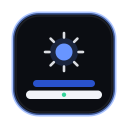

<div align="center">



# Mac Clamshell MCP

**Keep your MacBook cool, quiet, and its built-in screen truly off when running builds or AI agents with the lid closed.**

[](https://github.com/eatingDream-antigravity-plugins/mac-clamshell-mcp/actions/workflows/ci.yml)
[](https://github.com/eatingDream-antigravity-plugins/mac-clamshell-mcp/releases)
[](LICENSE)


English | [简体中文](README.zh-CN.md)


</div>

## Why this exists

If you leave a MacBook running builds, tests, or AI agents with the lid closed (for example while docked or working remotely), two annoying things happen: heavy jobs heat up the closed laptop and spin up the fans, and background apps sometimes keep the built-in screen lit right under the closed lid.

Mac Clamshell MCP watches your Mac's lid, power, and temperature. It makes sure the closed screen actually turns off, steers heavy tasks onto lower-heat settings automatically, and puts a clean status and brightness panel inside Antigravity.

## What it does

- **Turns off the closed built-in screen**: Automatically drops backlight to 0% and sleeps the internal display when the lid shuts (even when another app tries to keep the display awake), then restores your previous brightness when you open the lid again.
- **Throttles heavy builds automatically**: Adapts CPU priority and parallel job limits based on lid state, battery vs. AC power, and thermal pressure.
- **Stays out of the way when open**: When your lid is open and temps are fine, it stays completely silent in Antigravity. As soon as your Mac enters a throttled mode, it nudges the agent to wrap heavy commands and cap concurrency.
- **Live panel and brightness control**: Check lid, power, and thermal status in Antigravity, override the mode temporarily if you need full speed, or adjust the built-in display brightness from the panel or chat.

### Power & thermal modes

| Mode | When it activates | What it does |
| :--- | :--- | :--- |
| **Normal** | Lid open and cool | Full speed, no throttling |
| **Utility** | Lid closed on AC power | Lower CPU priority, limits jobs to efficiency cores (2 to 4) |
| **Eco** | Lid closed on battery | Background priority, max 2 jobs (1 job at 20% battery or below) |
| **Strict** | macOS reports thermal throttling | Lowest priority, 1 job at a time |

## Install

### macOS (Apple Silicon & Intel)

```sh
curl -fsSL https://raw.githubusercontent.com/eatingDream-antigravity-plugins/mac-clamshell-mcp/main/scripts/install.sh | sh
```

This downloads the macOS release binary, verifies its SHA-256 checksum, and installs the plugin into `~/.gemini/config/plugins/mac-clamshell-mcp`. Restart or reload Antigravity afterward.

To pin a specific release:

```sh
curl -fsSL https://raw.githubusercontent.com/eatingDream-antigravity-plugins/mac-clamshell-mcp/main/scripts/install.sh | sh -s -- --version v1.0.0
```

### Optional: keep the closed-lid screen guard running all the time

If you want closed-lid display protection even when Antigravity isn't open, install the background macOS LaunchAgent (checks every 10 seconds):

```sh
./scripts/install-launchagent.sh --interval 10
```

## How to use it

### In Antigravity

Open **Mac Clamshell** in the Antigravity side pane to check status, switch modes, or drag the brightness slider.

You can also ask your agent directly:

- *"Check my Mac's lid, battery, and thermal status."*
- *"Dim the built-in display to 30%."*
- *"Run the test suite using clamshell throttling."*

| Tool | What it does |
| :--- | :--- |
| `clamshell_panel` | Opens the live dashboard and reports current lid, power, thermal, and mode status. |
| `clamshell_set_brightness` | Sets built-in screen brightness (0 to 100%) immediately when open, or updates the wake-restore level while closed without lighting the screen. |

### From the terminal

You can also use the `mac-clamshell-mcp` CLI on its own:

```sh
# Check current lid, power, thermal, brightness, and active mode
mac-clamshell-mcp status

# Run a heavy build or test command with automatic throttling
mac-clamshell-mcp run -- cargo test
mac-clamshell-mcp run --mode eco --jobs 2 --sh "npm run build && npm test"

# Read or set built-in screen brightness (0-100%)
mac-clamshell-mcp brightness get
mac-clamshell-mcp brightness set 60

# Run the closed-lid display guard in the foreground
mac-clamshell-mcp watch --daemon --interval 10
```

## Privacy

Everything runs 100% locally on your Mac with zero network requests and no telemetry. Settings and display-guard state are stored only in your local user directory with owner-only permissions.

## Build from source

Requires macOS, Rust (`cargo`), and Node.js 20+ (only to pack and test the panel; no npm install needed).

```sh
git clone https://github.com/eatingDream-antigravity-plugins/mac-clamshell-mcp.git
cd mac-clamshell-mcp
node panel/pack.mjs && node --test panel/test/panel.test.mjs
cargo test --locked
cargo build --release --locked
./scripts/install-plugin.sh
```

## Contributing & License

Contributions are welcome. See [CONTRIBUTING.md](CONTRIBUTING.md), [CHANGELOG.md](CHANGELOG.md), and [SECURITY.md](SECURITY.md).

Licensed under the [MIT License](LICENSE).
