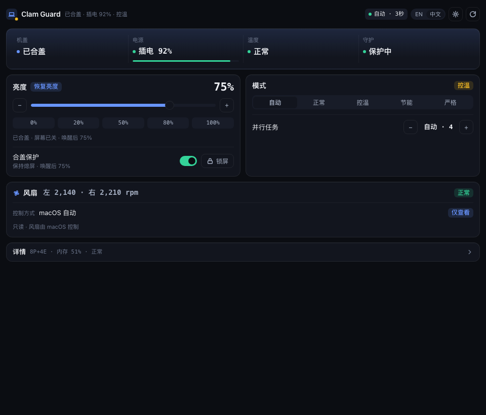

<div align="center">


# Clam Guard (`mac-clamshell-mcp`)

**Run agents with the lid closed, without cooking your Mac.**

Clam Guard keeps a MacBook awake with the screen dark when you close the lid, and eases off heavy work as it heats up. It reads fans and temperature but never takes over fan control.

[Homepage](https://clamguard.eatingdream.dev) · **English** | [简体中文](README.zh-CN.md) · [Releases](https://github.com/eatingDream-antigravity-plugins/clam-guard/releases) · [AI Guide](docs/ai-guide.md) · [`llms.txt`](llms.txt)

[](https://github.com/eatingDream-antigravity-plugins/clam-guard/actions/workflows/ci.yml)
[](https://github.com/eatingDream-antigravity-plugins/clam-guard/releases)


[](LICENSE)

<br>

<picture>
  <source media="(prefers-color-scheme: dark)" srcset="docs/images/clamguard-dashboard-dark.png">
  <source media="(prefers-color-scheme: light)" srcset="docs/images/clamguard-dashboard-light.png">
  
</picture>

</div>

## Is It For You?

- **Yes, if** you leave a MacBook closed while AI agents, compiles, or test suites keep running—and want automatic thermal throttling, closed-lid display protection, and instant brightness or lock controls without `sudo`.
- **No, if** you want a custom fan-curve writer, kernel extension, or global sleep blocker—Clam Guard never touches fan curves or requires administrator privileges.

## What You Get

| | |
| :--- | :--- |
| **Cooler closed-lid builds** | Automatically caps CPU priority and parallel jobs based on lid state, AC vs. battery, and macOS thermal pressure—and stays completely silent when your Mac is open and cool. |
| **External-display-safe lid guard** | Puts the built-in display to sleep when you close the lid undocked and restores your brightness when you open it; stays out of the way of external monitors when docked. |
| **Safe brightness & one-click lock** | Adjust built-in display brightness from the panel or agent (queued safely while closed so the panel never wakes in a bag) and lock the screen without pausing background tasks. |
| **Read-only fan visibility** | See live fan RPM and whether macOS or a fan app (`Macs Fan Control`, `TG Pro`, `smcFanControl`) is in charge—with zero SMC writes. |
| **Native Rust, zero `sudo`** | Single local binary for Apple Silicon and Intel Macs with zero outbound network calls and owner-only (`0600`) local settings. |

| Profile | Trigger | Effect |
| :--- | :--- | :--- |
| **Normal** | Lid open & cool | Full speed, no throttling |
| **Cool** (`utility`) | Lid closed on AC | Lower priority (`nice 10`), E-core job cap (`2–4`) |
| **Eco** | Lid closed on battery | Background priority (`nice 15`), max `2` jobs (`1` at `<=20%`) |
| **Strict** | Serious / critical heat | Lowest priority (`taskpolicy -b`, `nice 19`), `1` job |

## Quick Start

```sh
curl -fsSL https://raw.githubusercontent.com/eatingDream-antigravity-plugins/clam-guard/main/scripts/install.sh | sh
```

<sub>Verifies the release archive SHA-256 automatically · Refreshes live Antigravity MCP servers via `RefreshMcpServers` automatically (use `--reload` outside Antigravity or `--no-reload` to skip) · Supports macOS (Apple Silicon & Intel) · Pin a tag with `MAC_CLAMSHELL_VERSION=vX.Y.Z` · Remove cleanly anytime with `curl -fsSL https://raw.githubusercontent.com/eatingDream-antigravity-plugins/clam-guard/main/scripts/install.sh | sh -s -- --uninstall`.</sub>

Reload Antigravity to open **Clam Guard**, or run directly in your terminal:

```sh
mac-clamshell-mcp status
mac-clamshell-mcp run -- cargo test
mac-clamshell-mcp guard install --interval 10   # Optional 24/7 background guard
```

## For AI Agents

Install the portable skill for Antigravity, Claude Code, Codex, Cursor, or OpenCode:

```sh
npx skills add eatingDream-antigravity-plugins/clam-guard
```

> **Agent hint**: Read [`llms.txt`](llms.txt), [`skills/mac-clamshell/SKILL.md`](skills/mac-clamshell/SKILL.md), and [`docs/ai-guide.md`](docs/ai-guide.md) for MCP tool schemas, CLI flags, throttling rules, and LaunchAgent commands.

## Safety & Privacy

- **Zero network & zero `sudo`**: Makes no outbound network calls, collects no analytics, and never writes SMC, NVRAM, or kernel extensions.
- **Reversible user-space controls**: Never changes brightness unless hardware confirms the lid is open and the internal display is awake.
- **Transparent local telemetry**: Over local MCP stdio, shares host status (lid, battery, thermal pressure, fan RPM, load, memory, and `~/...` paths) only with your connected local client.

## Documentation

- [AI Agent Guide & Reference](docs/ai-guide.md) — MCP tools, CLI flags, throttle matrix, display & fan semantics, source build
- [Portable Agent Skill (`SKILL.md`)](skills/mac-clamshell/SKILL.md) · [LLM Index (`llms.txt`)](llms.txt)
- [Contributor Guide](AGENTS.md) · [Contributing](CONTRIBUTING.md) · [Changelog](CHANGELOG.md) · [Security](SECURITY.md)

## Antigravity Plugin Suite

Part of the [Antigravity Plugins](https://github.com/eatingDream-antigravity-plugins) suite: [Context Radar](https://github.com/eatingDream-antigravity-plugins/context-radar) · **Clam Guard** · [Remote Cast](https://github.com/eatingDream-antigravity-plugins/remote-cast) · [Colab Deck](https://github.com/eatingDream-antigravity-plugins/colab-deck) · [Panel Kit](https://github.com/eatingDream-antigravity-plugins/panel-kit)

## License

Licensed under the [MIT License](LICENSE).
