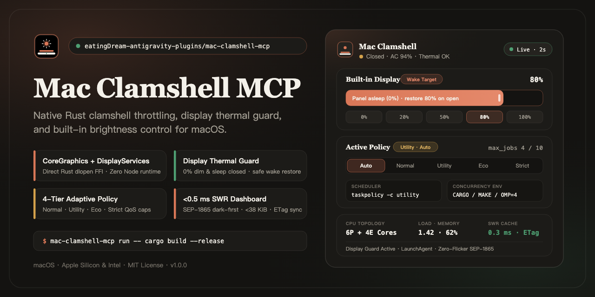
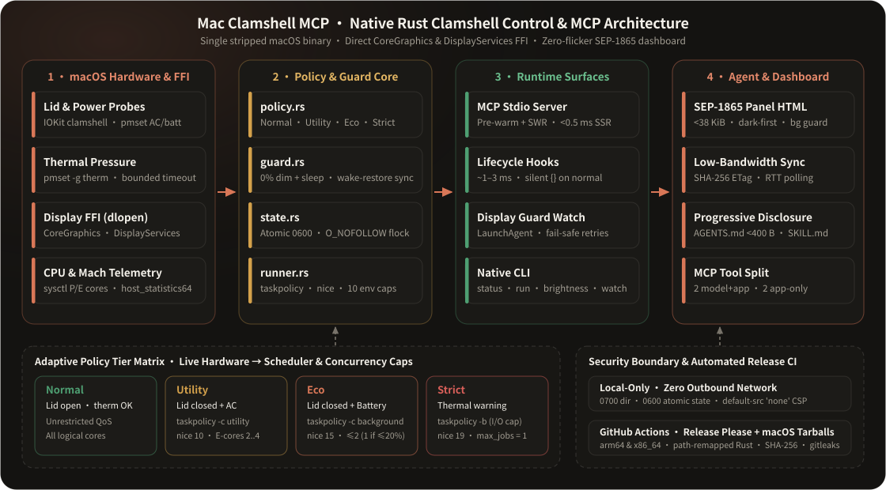

<div align="center">


# Mac Clamshell MCP

**Native Rust macOS clamshell performance controller, display thermal guard, built-in brightness manager, and zero-flicker SEP-1865 MCP dashboard.**

[](https://github.com/eatingDream-antigravity-plugins/mac-clamshell-mcp/actions/workflows/ci.yml)
[](https://github.com/eatingDream-antigravity-plugins/mac-clamshell-mcp/releases)
[](LICENSE)


English | [简体中文](README.zh-CN.md)



<sub>Single stripped macOS binary with native CoreGraphics &amp; DisplayServices FFI, automatic clamshell throttling, and a &lt;38 KiB dark-first MCP Apps panel.</sub>

</div>

## Features

- **Lid / Power / Thermal Policy Engine** — Continuously evaluates `AppleClamshellState`, AC vs. battery power, low-battery threshold (`<= 20%`), Apple Silicon P/E-core topology, and `pmset -g therm` pressure into four tiers (`normal`, `utility`, `eco`, `strict`).
- **Display Thermal Guard (`watch`)** — Automatically dims the built-in backlight to `0%` and sleeps the internal display whenever the lid closes (even when apps hold `NoDisplaySleepAssertion`), skips redundant CoreGraphics/disk work in steady state, fails safe on `ioreg` timeouts, and retries across lid-open wake races.
- **Apple Silicon & macOS Brightness Control** — Direct `dlopen`/`dlsym` FFI bindings to `CoreGraphics` (`CGGetOnlineDisplayList`, `CGDisplayIsBuiltin`, `CGDisplayIsAsleep`) and `DisplayServices` (`DisplayServicesGetBrightness`, `DisplayServicesSetBrightness`). Adjusts `0%–100%` brightness immediately while open and awake, or safely updates the wake-restore target while closed without lighting the closed panel — synchronized via `O_NOFOLLOW` `flock` (`0600`).
- **Adaptive `run` Wrapper** — Wraps heavy builds, tests, and scripts with live `taskpolicy` (`-c utility` / `-c background` / `-b`), `nice`, and 10 concurrency environment variables (`MAKEFLAGS`, `CARGO_BUILD_JOBS`, `CMAKE_BUILD_PARALLEL_LEVEL`, `OMP_NUM_THREADS`, `OPENBLAS_NUM_THREADS`, `MKL_NUM_THREADS`, `VECLIB_MAXIMUM_THREADS`, `RAYON_NUM_THREADS`, `UV_THREADPOOL_SIZE`, `GOMAXPROCS`).
- **Zero-Flicker MCP Dashboard (`ui://mac-clamshell-mcp/panel`)** — Self-contained SEP-1865 (`2026-01-26`) single-file HTML (`<38 KiB`, `default-src 'none'`, zero external URLs), dark-first frame-0 lock (`#141311`) with transparent host CSS variable protection, startup pre-warm + single-flight SWR cache (`<0.5 ms` SSR `resources/read`), SHA-256 ETag `unchanged: true` deduplication, RTT-adaptive polling with `document.hidden` pause, optimistic controls, and a `250ms` debounced last-write-wins brightness slider.

### Adaptive Profile Tiers

| Profile | Trigger | Scheduler / QoS | Concurrency (`max_jobs`) |
| :--- | :--- | :--- | :--- |
| **Normal** | Lid open, thermal OK | Unrestricted | All logical cores |
| **Utility** | Lid closed + AC power | `taskpolicy -c utility`, `nice 10` | E-cores (`2..4`) |
| **Eco** | Lid closed + Battery | `taskpolicy -c background`, `nice 15` | `<= 2` (`1` when battery `<= 20%`) |
| **Strict** | Thermal warning / throttle | `taskpolicy -b`, `nice 19` | `1` |

## Architecture

<p align="center"></p>

1. **macOS Hardware & FFI (`src/platform/`)** reads lid state (`IOKit`), power/thermal pressure (`pmset`), CPU topology & memory (`sysctlbyname`, `getloadavg`, Mach `host_statistics64`), and built-in display state (`CoreGraphics` + `DisplayServices` `dlopen` FFI).
2. **Policy & Guard Core (`src/policy.rs`, `src/guard.rs`, `src/state.rs`, `src/runner.rs`)** resolves the active 4-tier profile, coordinates closed-lid backlight dimming & wake restoration under `O_NOFOLLOW` `flock`, and wraps heavy commands with `taskpolicy`/`nice`/concurrency caps.
3. **Runtime Surfaces (`src/cli.rs`, `src/hook.rs`, `src/mcp/`)** exposes a single stripped Rust binary for CLI commands, `~1–3 ms` fail-open lifecycle hooks, the LaunchAgent display guard, and a pre-warmed SWR JSON-RPC 2.0 MCP server.
4. **Agent & MCP Dashboard (`panel/`, `plugin/`)** delivers an editorial-warm `<38 KiB` SEP-1865 HTML panel, `<400 B` always-on rules, and an on-demand agent skill.

## Quick Install

### One-Line Release Installer (macOS Apple Silicon & Intel)

Downloads the matching `aarch64-apple-darwin` or `x86_64-apple-darwin` release archive, verifies its SHA-256 checksum, and installs cleanly into `${ANTIGRAVITY_PLUGINS_DIR:-$HOME/.gemini/config/plugins}/mac-clamshell-mcp`:

```sh
curl -fsSL https://raw.githubusercontent.com/eatingDream-antigravity-plugins/mac-clamshell-mcp/main/scripts/install.sh | sh
```

Pin a specific version or destination:

```sh
curl -fsSL https://raw.githubusercontent.com/eatingDream-antigravity-plugins/mac-clamshell-mcp/main/scripts/install.sh | sh -s -- --version v1.0.0
```

### Build from Source

Requirements: macOS (Apple Silicon or Intel), Rust toolchain (`cargo`), and Node.js 20+ (to bundle `panel/dist/panel.html`).

```sh
git clone https://github.com/eatingDream-antigravity-plugins/mac-clamshell-mcp.git
cd mac-clamshell-mcp

# 1. Pack and test the lean SEP-1865 panel HTML
(cd panel && npm install) && node panel/pack.mjs && node --test panel/test/panel.test.mjs

# 2. Build the stripped, path-remapped release binary
RUSTFLAGS="--remap-path-prefix=$HOME=/build" cargo build --release --locked

# 3. Install into ~/.gemini/config/plugins/mac-clamshell-mcp (atomic binary swap)
./scripts/install-plugin.sh
```

### Optional macOS LaunchAgent (Background Display Thermal Guard)

Install and load `~/Library/LaunchAgents/dev.mac-clamshell-mcp.display-guard.plist` so your built-in display stays safely dimmed and asleep whenever the lid closes (even outside agent sessions):

```sh
./scripts/install-launchagent.sh --interval 10
```

## Agent Integration & Skill

`mac-clamshell-mcp` uses **low-intrusion progressive disclosure** so agent context stays virtually untouched during normal open-lid work:

- **`plugin/rules/AGENTS.md` (`<400 B`)** — Tiny plain-markdown always-on rule telling the agent to operate normally unless an active `[mac-clamshell]` throttle notice appears.
- **`plugin/skills/mac-clamshell/SKILL.md`** — On-demand skill loaded only when throttled (`utility`, `eco`, `strict`) or when the user asks about clamshell status, build wrapping, or built-in brightness.
- **`plugin/hooks.json`** — Runs `mac-clamshell-mcp hook session-start` and `pre-invocation` with an early-exit balanced-JSON stdin reader (`~1–3 ms`, always fail-open). Returns silent `{}` whenever `profile=normal`.

### MCP Tools

| Tool | Visibility | Description |
| :--- | :--- | :--- |
| `clamshell_panel` | Model + App (`global` & `aux_pane`) | Opens the live Mac Clamshell dashboard (`ui://mac-clamshell-mcp/panel`) and returns concise hardware/policy telemetry. |
| `clamshell_set_brightness` | Model + App | Adjusts built-in display brightness (`0–100%`) immediately when awake, or safely updates the wake-restore target while closed. |
| `clamshell_refresh` | App only | Polls fresh telemetry with `ifHash` SHA-256 ETag deduplication (`unchanged: true`). |
| `clamshell_configure` | App only | Persists mode override (`auto`/`normal`/`utility`/`eco`/`strict`), `max_jobs` cap, or closed-AC default profile. |

## CLI Usage

```sh
# Status: inspect live lid, power, thermal pressure, display brightness, and active policy
mac-clamshell-mcp status
mac-clamshell-mcp status --json

# Run: wrap heavy builds/tests with live clamshell & thermal throttling
mac-clamshell-mcp run -- cargo test
mac-clamshell-mcp run --mode eco --jobs 2 --sh "npm run build && npm test"

# Brightness: read or set built-in display brightness (0-100%) synced with wake-restore
mac-clamshell-mcp brightness get --json
mac-clamshell-mcp brightness set 60

# Display Guard: run a single check (LaunchAgent StartInterval) or foreground daemon
mac-clamshell-mcp watch
mac-clamshell-mcp watch --daemon --interval 10

# MCP Server: start JSON-RPC 2.0 stdio transport
mac-clamshell-mcp serve --data-dir "$HOME/.gemini/antigravity/plugin_data/mac-clamshell-mcp"
```

## Security & Privacy Boundary

- **Zero outbound network at runtime** — All probes, FFI calls, state storage, hooks, and MCP stdio traffic stay 100% local on your Mac. The bundled dashboard HTML contains zero external URLs and enforces strict `default-src 'none'` CSP compatibility.
- **Hardened local state** — Writable runtime files (`settings.json`, `display-guard-state.json`, `display-guard.lock`) live inside a dedicated `0700` data directory with `0600` atomic temp-file renames and `O_NOFOLLOW` `flock` locking to prevent symlink races.
- **Reproducible, clean binaries** — Release artifacts are compiled with `RUSTFLAGS="--remap-path-prefix=$HOME=/build"`, LTO, and symbol stripping; CI enforces `cargo test`, panel tests, `gitleaks` full-history scanning, and `scripts/check_sanitized.sh`.

## Project Structure

```text
mac-clamshell-mcp/
├── src/
│   ├── main.rs                # Entry point
│   ├── cli.rs                 # CLI subcommands (serve, status, brightness, run, hook, watch)
│   ├── policy.rs              # Lid/power/thermal -> profile, taskpolicy, nice, max_jobs rules
│   ├── state.rs               # Atomic 0600 persistence, O_NOFOLLOW flock, FIPS 180-4 SHA-256
│   ├── guard.rs               # Display thermal guard state machine & synced brightness control
│   ├── runner.rs              # Native taskpolicy + nice + concurrency env exec wrapper
│   ├── hook.rs                # ~1-3 ms lifecycle hooks with early-exit JSON stdin reader
│   ├── platform/
│   │   ├── display_ffi.rs     # Native CoreGraphics & DisplayServices dlopen FFI
│   │   └── macos.rs           # Native sysctl/Mach VM stats + bounded ioreg/pmset probes
│   └── mcp/
│       ├── telemetry.rs       # Pre-warm, SWR cache, single-flight coalescer, ETag
│       ├── tools.rs           # MCP tools + SSR boot payload injection
│       └── server.rs          # JSON-RPC 2.0 stdio transport
├── panel/                     # SEP-1865 UI source, tests & packer -> panel/dist/panel.html
├── plugin/                    # Antigravity plugin.json, mcp_config.json, hooks, AGENTS.md, SKILL.md
├── scripts/                   # install.sh, install-plugin.sh, install-launchagent.sh, check_sanitized.sh
├── docs/                      # Architecture SVGs (EN/ZH) & social preview
├── assets/                    # Brand logo SVG
├── tests/                     # Rust integration test suite
└── .github/workflows/         # CI, Release Please & macOS arm64/x86_64 release packaging
```

## Contributing & License

Pull requests are welcome — see [CONTRIBUTING.md](CONTRIBUTING.md) for branch, commit, and local verification steps, and [CHANGELOG.md](CHANGELOG.md) for release history. Please report security vulnerabilities privately per [SECURITY.md](SECURITY.md).

Licensed under the [MIT License](LICENSE).
