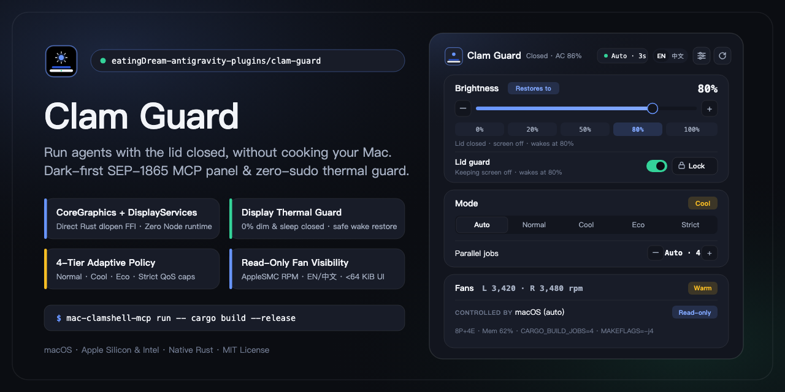

<div align="center">


# Mac Clamshell MCP

**让合盖干活的 MacBook 保持凉快安静，同时确保合盖后内置屏幕彻底熄灭。**

[](https://github.com/eatingDream-antigravity-plugins/mac-clamshell-mcp/actions/workflows/ci.yml)
[](https://github.com/eatingDream-antigravity-plugins/mac-clamshell-mcp/releases)
[](LICENSE)


[English](README.md) | 简体中文



</div>

## 为什么做这个插件

把 MacBook 合上盖子跑编译、跑测试或者让 AI Agent 后台干活（比如远程控制或外接使用时），经常会遇到两件烦心事：满载任务把合盖的机身烤得发烫、风扇狂转，而且有些软件会阻止屏幕休眠，导致盖子合上了内置屏幕背光还偷偷亮着。

Mac Clamshell MCP 会监测 Mac 的开合盖、供电和发热状态：合盖时确保内屏真正熄灭，自动把重任务降到更温和的负载档位，并在 Antigravity 里提供一个直观的状态和亮度控制面板。

## 它能帮你做什么

- **合盖彻底熄屏，开盖恢复亮度**：检测到合盖就自动把内置屏幕背光降到 0% 并让内屏休眠（即使有软件阻止屏幕休眠也能压住），等你重新掀开盖子再自动恢复原来的亮度。
- **按状态自动限流降温**：根据开合盖、插电还是用电池、以及系统是否发热降频，自动调整任务的 CPU 优先级和并发数。
- **开盖时完全不打扰**：平时开着盖子且温度正常时，插件在 Antigravity 里保持静默；只有进入合盖或发热限流档位后，才会提醒 Agent 自动限制编译并发。
- **在面板或对话里调亮度、切档位**：随时在侧边栏看设备状态、临时切回全速，或者直接调节内置屏幕亮度。

### 四档自动策略

| 档位 | 触发条件 | 实际效果 |
| :--- | :--- | :--- |
| **Normal** | 开盖且温度正常 | 不限制，全速运行 |
| **Utility** | 合盖 + 插电 | 降低 CPU 优先级，把并发限制在能效核数量（2 到 4） |
| **Eco** | 合盖 + 电池供电 | 后台低优先级，最多 2 并发（电量低于等于 20% 时降为 1） |
| **Strict** | 系统出现明显发热降频 | 最低优先级，单任务串行运行 |

## 安装

### macOS（Apple Silicon 与 Intel 均支持）

```sh
curl -fsSL https://raw.githubusercontent.com/eatingDream-antigravity-plugins/mac-clamshell-mcp/main/scripts/install.sh | sh
```

脚本会下载对应芯片架构的预编译版本，校验 SHA-256 后安装到 `~/.gemini/config/plugins/mac-clamshell-mcp`。装完后重启或重载 Antigravity 即可。

如需指定版本：

```sh
curl -fsSL https://raw.githubusercontent.com/eatingDream-antigravity-plugins/mac-clamshell-mcp/main/scripts/install.sh | sh -s -- --version v1.0.0
```

### 可选：让合盖熄屏保护常驻后台

如果你希望不开 Antigravity 时也保持合盖熄屏保护，可以装一下附带的 macOS LaunchAgent（每 10 秒检查一次）：

```sh
./scripts/install-launchagent.sh --interval 10
```

## 怎么用

### 在 Antigravity 里用

从侧边栏打开 **Mac Clamshell** 面板，可以查看实时状态、手动覆盖档位或拖动亮度条。

也可以直接让 Agent 帮你操作：

- *"看看我这台 Mac 现在的开合盖、电量和温度状态。"*
- *"把内置屏幕亮度调到 30%。"*
- *"用合盖限流模式跑一下测试。"*

| 工具 | 作用 |
| :--- | :--- |
| `clamshell_panel` | 打开控制面板，返回当前开合盖、供电、温度和档位信息。 |
| `clamshell_set_brightness` | 调节内置屏幕亮度（0% 到 100%）。合盖状态下只会记住开盖后要恢复的亮度，不会误点亮黑屏。 |

### 在终端里单独用

`mac-clamshell-mcp` 也可以直接当命令行工具使用：

```sh
# 查看当前开合盖、供电、温度、亮度和档位
mac-clamshell-mcp status

# 自动按当前档位包裹重型编译或测试命令
mac-clamshell-mcp run -- cargo test
mac-clamshell-mcp run --mode eco --jobs 2 --sh "npm run build && npm test"

# 读取或设置内置屏幕亮度（0-100%）
mac-clamshell-mcp brightness get
mac-clamshell-mcp brightness set 60

# 前台持续运行合盖熄屏保护
mac-clamshell-mcp watch --daemon --interval 10
```

## 隐私与安全

完全在你的 Mac 本地运行，没有任何联网请求和统计上报。配置与状态文件只保存在本地用户目录中，仅当前用户可读写。

## 从源码构建

需要 macOS、Rust（`cargo`）和 Node.js 20+（用于打包和测试前端面板）。

```sh
git clone https://github.com/eatingDream-antigravity-plugins/mac-clamshell-mcp.git
cd mac-clamshell-mcp
(cd panel && npm install) && node panel/pack.mjs && node --test panel/test/panel.test.mjs
cargo test --locked
cargo build --release --locked
./scripts/install-plugin.sh
```

## 参与贡献与许可证

欢迎提 PR 或反馈问题，详情见 [CONTRIBUTING.md](CONTRIBUTING.md)、[CHANGELOG.md](CHANGELOG.md) 和 [SECURITY.md](SECURITY.md)。

本项目基于 [MIT License](LICENSE) 开源。
