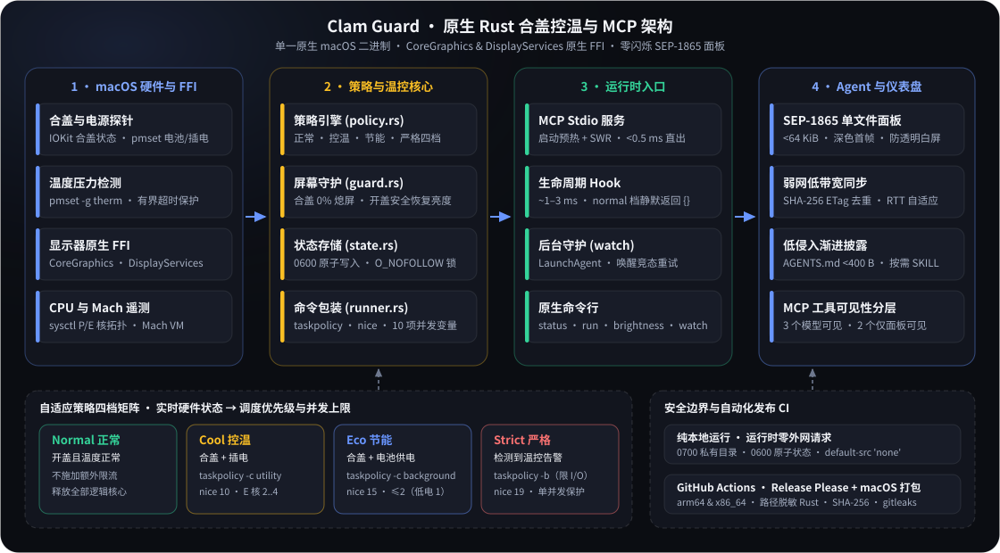

<div align="center">


# Mac Clamshell MCP

**原生 Rust 编写的 macOS 合盖性能控温、内建屏幕温控守护、亮度管理与零闪烁 SEP-1865 MCP 面板。**

[](https://github.com/eatingDream-antigravity-plugins/mac-clamshell-mcp/actions/workflows/ci.yml)
[](https://github.com/eatingDream-antigravity-plugins/mac-clamshell-mcp/releases)
[](LICENSE)


[English](README.md) | 简体中文


<sub>单一精简 macOS 原生二进制，集成 CoreGraphics 与 DisplayServices 原生 FFI、自适应合盖限流以及 &lt;38 KiB 深色首帧 MCP 仪表盘。</sub>

</div>

## 特性

- **合盖 / 电源 / 温控策略引擎** — 实时综合 `AppleClamshellState` 合盖状态、插电/电池供电、低电量阈值（`<= 20%`）、Apple Silicon P/E 核拓扑以及 `pmset -g therm` 温控压力，自动映射到 `normal`、`utility`、`eco`、`strict` 四个档位。
- **内建屏幕温控守护（`watch`）** — 合盖后自动将内建屏背光降至 `0%` 并令内建屏幕休眠（即使存在持有 `NoDisplaySleepAssertion` 的应用也能生效），稳态下跳过冗余 CoreGraphics/磁盘操作，`ioreg` 超时安全降级，并在开盖唤醒竞态下自动重试恢复。
- **Apple Silicon 与 macOS 原生亮度控制** — 通过 `dlopen`/`dlsym` 直接调用 `CoreGraphics`（`CGGetOnlineDisplayList`、`CGDisplayIsBuiltin`、`CGDisplayIsAsleep`）与 `DisplayServices`（`DisplayServicesGetBrightness`、`DisplayServicesSetBrightness`）。开盖亮屏时即时生效 `0%–100%` 调节；合盖或休眠时仅安全更新开盖恢复目标而不点亮已闭合面板，并通过 `O_NOFOLLOW` `flock`（`0600`）与守护状态同步。
- **自适应 `run` 命令包装器** — 启动重构建、测试与脚本时实时评估硬件状态，自动施加 `taskpolicy`（`-c utility` / `-c background` / `-b`）、`nice` 与 10 项并发环境变量上限（`MAKEFLAGS`、`CARGO_BUILD_JOBS`、`CMAKE_BUILD_PARALLEL_LEVEL`、`OMP_NUM_THREADS`、`OPENBLAS_NUM_THREADS`、`MKL_NUM_THREADS`、`VECLIB_MAXIMUM_THREADS`、`RAYON_NUM_THREADS`、`UV_THREADPOOL_SIZE`、`GOMAXPROCS`）。
- **零闪烁 MCP 面板（`ui://mac-clamshell-mcp/panel`）** — 自包含 SEP-1865（`2026-01-26`）单文件 HTML（`<38 KiB`、`default-src 'none'`、零外链），深色首帧锁死（`#141311`）并内置宿主透明背景变量防护，支持启动预热 + Single-Flight SWR 缓存（`<0.5 ms` SSR 直出）、SHA-256 ETag `unchanged: true` 去重、RTT 自适应轮询与 `document.hidden` 自动暂停、乐观更新以及 `250ms` 防抖末次生效亮度滑块。

### 自适应性能档位

| 档位 | 触发条件 | 调度策略 / QoS | 并发上限（`max_jobs`） |
| :--- | :--- | :--- | :--- |
| **Normal 正常** | 开盖且温度正常 | 无额外限流 | 全部逻辑核心 |
| **Utility 控温** | 合盖 + 插电 | `taskpolicy -c utility`、`nice 10` | E 核数（`2..4`） |
| **Eco 节能** | 合盖 + 电池供电 | `taskpolicy -c background`、`nice 15` | `<= 2`（电量 `<= 20%` 时为 `1`） |
| **Strict 强限** | 检测到温控告警 / 降频 | `taskpolicy -b`、`nice 19` | `1` |

## 架构

<p align="center"></p>

1. **macOS 硬件与原生 FFI（`src/platform/`）** 负责读取合盖状态（`IOKit`）、电源与温控压力（`pmset`）、CPU 拓扑与内存（`sysctlbyname`、`getloadavg`、Mach `host_statistics64`）以及内建显示器状态（`CoreGraphics` + `DisplayServices` `dlopen` FFI）。
2. **策略与守护核心（`src/policy.rs`、`src/guard.rs`、`src/state.rs`、`src/runner.rs`）** 负责四档策略推导、在 `O_NOFOLLOW` `flock` 保护下协调合盖熄屏与开盖亮度恢复，并用 `taskpolicy`/`nice`/并发变量包装重型任务。
3. **运行时入口（`src/cli.rs`、`src/hook.rs`、`src/mcp/`）** 以单一精简 Rust 二进制提供命令行、`~1–3 ms` 故障开放生命周期 Hook、LaunchAgent 屏幕守护以及带启动预热和 SWR 缓存的 JSON-RPC 2.0 MCP 服务。
4. **Agent 与 MCP 面板（`panel/`、`plugin/`）** 提供暖色调编辑风 `<38 KiB` SEP-1865 面板、`<400 B` 常驻规则与按需加载 Skill。

## 快速安装

### 一键安装预编译发布包（macOS Apple Silicon & Intel）

自动匹配 `aarch64-apple-darwin` 或 `x86_64-apple-darwin` 发布包、校验 SHA-256 摘要，并原子安装至 `${ANTIGRAVITY_PLUGINS_DIR:-$HOME/.gemini/config/plugins}/mac-clamshell-mcp`：

```sh
curl -fsSL https://raw.githubusercontent.com/eatingDream-antigravity-plugins/mac-clamshell-mcp/main/scripts/install.sh | sh
```

指定版本或目标目录：

```sh
curl -fsSL https://raw.githubusercontent.com/eatingDream-antigravity-plugins/mac-clamshell-mcp/main/scripts/install.sh | sh -s -- --version v1.0.0
```

### 从源码构建

环境要求：macOS（Apple Silicon 或 Intel）、Rust 工具链（`cargo`）、Node.js 20+（用于打包 `panel/dist/panel.html`）。

```sh
git clone https://github.com/eatingDream-antigravity-plugins/mac-clamshell-mcp.git
cd mac-clamshell-mcp

# 1. 打包并测试轻量 SEP-1865 面板
(cd panel && npm install) && node panel/pack.mjs && node --test panel/test/panel.test.mjs

# 2. 构建精简且路径脱敏的 Release 二进制
RUSTFLAGS="--remap-path-prefix=$HOME=/build" cargo build --release --locked

# 3. 原子安装至 ~/.gemini/config/plugins/mac-clamshell-mcp
./scripts/install-plugin.sh
```

### 可选：安装 macOS LaunchAgent（后台屏幕温控守护）

安装并加载 `~/Library/LaunchAgents/dev.mac-clamshell-mcp.display-guard.plist`，即使不在 Agent 会话内也能在合盖后自动熄灭内建屏幕背光：

```sh
./scripts/install-launchagent.sh --interval 10
```

## Agent 集成与 Skill

`mac-clamshell-mcp` 遵循 **低侵入渐进披露** 设计，正常开盖工作时几乎不占用 Agent 上下文：

- **`plugin/rules/AGENTS.md`（`<400 B`）** — 极简纯 Markdown 常驻规则，仅提示 Agent 在收到 `[mac-clamshell]` 限流通知时按需加载 Skill。
- **`plugin/skills/mac-clamshell/SKILL.md`** — 按需加载技能，仅在进入 `utility` / `eco` / `strict` 限流档位，或用户主动询问合盖状态、构建限流与屏幕亮度时加载。
- **`plugin/hooks.json`** — 注册 `SessionStart` 与 `PreInvocation` 生命周期钩子，使用提前退出平衡 JSON 读取器（`~1–3 ms`，始终 fail-open），`profile=normal` 时静默输出 `{}`。

### MCP 工具清单

| 工具 | 可见性 | 说明 |
| :--- | :--- | :--- |
| `clamshell_panel` | 模型 + 面板（`global` & `aux_pane`） | 打开 Mac Clamshell 实时仪表盘（`ui://mac-clamshell-mcp/panel`）并返回精简硬件与策略遥测。 |
| `clamshell_set_brightness` | 模型 + 面板 | 调节内建屏亮度（`0–100%`）：开盖唤醒时立即生效，合盖时安全更新开盖恢复目标。 |
| `clamshell_refresh` | 仅面板可见 | 带 `ifHash` SHA-256 ETag 去重的遥测刷新（未变更时返回 `unchanged: true`）。 |
| `clamshell_configure` | 仅面板可见 | 持久化模式覆盖（`auto`/`normal`/`utility`/`eco`/`strict`）、`max_jobs` 上限或合盖插电默认档位。 |

## CLI 用法

```sh
# 状态检查：查看实时合盖状态、电源、温控压力、内建屏亮度与当前策略
mac-clamshell-mcp status
mac-clamshell-mcp status --json

# 命令限流：按实时合盖与温控策略包装重构建与测试任务
mac-clamshell-mcp run -- cargo test
mac-clamshell-mcp run --mode eco --jobs 2 --sh "npm run build && npm test"

# 亮度管理：读取或设置内建屏亮度（0-100%），与开盖恢复目标同步
mac-clamshell-mcp brightness get --json
mac-clamshell-mcp brightness set 60

# 屏幕温控守护：单次巡检（供 LaunchAgent StartInterval 调用）或前台守护模式
mac-clamshell-mcp watch
mac-clamshell-mcp watch --daemon --interval 10

# 启动 MCP Stdio 服务
mac-clamshell-mcp serve --data-dir "$HOME/.gemini/antigravity/plugin_data/mac-clamshell-mcp"
```

## 安全与隐私边界

- **运行时零外网通信** — 所有硬件探针、原生 FFI、状态读写、Hook 与 MCP Stdio 通信均 100% 在本机完成；面板 HTML 不含任何外部 URL，遵循严格 `default-src 'none'` CSP 约束。
- **本地状态加固** — 可写运行状态（`settings.json`、`display-guard-state.json`、`display-guard.lock`）隔离在 `0700` 专用数据目录中，采用 `0600` 临时文件原子替换与 `O_NOFOLLOW` `flock` 文件锁，杜绝符号链接竞争。
- **可复现干净二进制** — 发布产物启用 `RUSTFLAGS="--remap-path-prefix=$HOME=/build"`、LTO 与符号剥离；CI 自动执行 `cargo test`、面板测试、`gitleaks` 全历史密钥扫描及 `scripts/check_sanitized.sh`。

## 目录结构

```text
mac-clamshell-mcp/
├── src/
│   ├── main.rs                # 程序入口
│   ├── cli.rs                 # CLI 子命令（serve、status、brightness、run、hook、watch）
│   ├── policy.rs              # 合盖 / 电源 / 温控 → 档位、taskpolicy、nice、max_jobs 规则
│   ├── state.rs               # 0600 原子持久化、O_NOFOLLOW flock、FIPS 180-4 SHA-256
│   ├── guard.rs               # 屏幕温控守护状态机与同步亮度控制
│   ├── runner.rs              # 原生 taskpolicy + nice + 并发环境变量执行包装器
│   ├── hook.rs                # ~1-3 ms 生命周期钩子与提前退出 JSON 读取器
│   ├── platform/
│   │   ├── display_ffi.rs     # CoreGraphics 与 DisplayServices 原生 dlopen FFI
│   │   └── macos.rs           # sysctl / Mach VM 统计 + 有界超时 ioreg/pmset 探针
│   └── mcp/
│       ├── telemetry.rs       # 启动预热、SWR 缓存、Single-Flight 合并、ETag
│       ├── tools.rs           # MCP 工具实现与 SSR 启动数据注入
│       └── server.rs          # JSON-RPC 2.0 Stdio 传输层
├── panel/                     # SEP-1865 面板源码、测试与打包脚本 → panel/dist/panel.html
├── plugin/                    # Antigravity plugin.json、mcp_config.json、hooks、AGENTS.md、SKILL.md
├── scripts/                   # install.sh、install-plugin.sh、install-launchagent.sh、check_sanitized.sh
├── docs/                      # 中英文架构图 SVG 与社交预览图
├── assets/                    # 品牌 Logo SVG
├── tests/                     # Rust 集成测试集
└── .github/workflows/         # CI、Release Please 与 macOS arm64/x86_64 自动发布流水线
```

## 参与贡献与许可

欢迎提交 PR！开发与验证流程请参阅 [CONTRIBUTING.md](CONTRIBUTING.md)，版本变更记录见 [CHANGELOG.md](CHANGELOG.md)；若发现安全漏洞，请按 [SECURITY.md](SECURITY.md) 私下报告。

本项目采用 [MIT 许可证](LICENSE) 开源。
